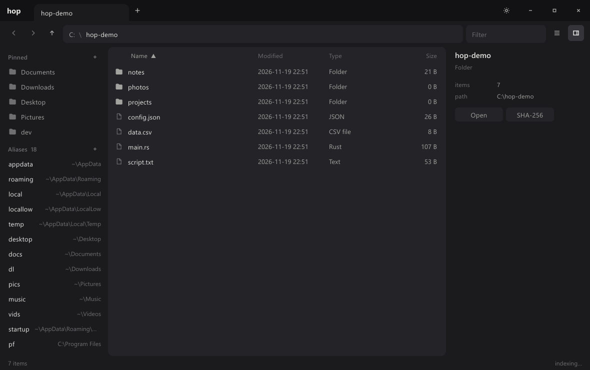
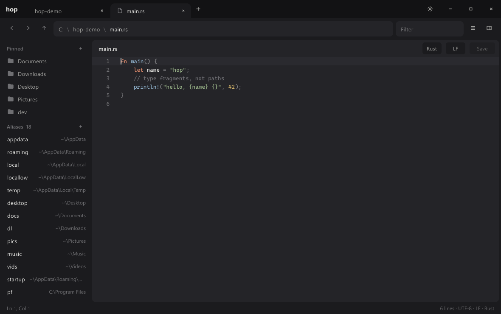

<p align="center"></p>

# hop

A file explorer for Windows you can type at. Press `/` or `Ctrl+L` and write fragments:
`appdata local ath ver` opens `AppData\Local\Athena\versions`.

Native Rust + [Slint](https://slint.dev), software-rendered: no webview, no GPU driver, about **45–60 MB of RAM** and
0% CPU when idle.



## What it does

- **Go bar.** Fragments resolve level by level (prefix, word start, initials, typo, fuzzy), backed by a background
  index of folder names. Aliases, `%env%` variables, drives and the folders you use most rank first. The bar shows how
  each fragment was matched.
- **Rows or tiles**, chosen per folder: automatic (mostly pictures become tiles) or pinned by you.
- **Previews.** Real Windows thumbnails for images, videos and PDFs, and real icons for programs.
- **Folder sizes**, computed lazily for the folders you can see, with a time budget (`≥ 3.2 GB` when cut short).
- **Built-in editor** in tabs, with highlighting for 36 languages, find, undo, and CRLF/BOM kept as they were.
  Diff and patch files get red and green line tints.
- **Language detection.** If a `.txt` is full of Lua, hop highlights it as Lua and offers to rename the file. It never
  renames on its own.
- **Safe file operations.** Deletes go to the Recycle Bin and every operation can be undone. Drag rows onto a folder to
  move them.
- Tabs, pinned folders and aliases, a details pane, a dark and a light theme, and animations you can switch off.
- One window: launching hop again brings the first one to the front.



## Install

Grab `hop-windows-x64.exe` from the [releases](../../releases) page and run it. There is no installer and no
dependency. Settings live in `%APPDATA%\hop\config.json`.

## Build

You need a recent stable Rust toolchain and the MSVC build tools (Visual Studio Build Tools, "Desktop development with
C++").

```powershell
cargo run --release              # build and run
cargo test                       # language tables and language detection
```

To make a release exe with **no machine-specific paths** in it (Rust otherwise embeds your user name and project folder
in panic messages), build with the script instead:

```powershell
powershell -ExecutionPolicy Bypass -File scripts\build-release.ps1
```

Options while running: `--cwd <folder>` opens a folder. `HOP_RENDERER=gpu` switches from the software renderer to GPU
rendering, which uses far more memory. A crash writes its reason to `%APPDATA%\hop\crash.txt`.

## Keys

| | |
|---|---|
| `/` or `Ctrl+L` | go bar |
| `Alt+←` `Alt+→` `Alt+↑` | back, forward, up |
| `Ctrl+T` `Ctrl+W` `Ctrl+Tab` | new, close, next tab |
| `Ctrl+D` | pin or unpin the current folder |
| `Ctrl+H` | show hidden items |
| `F2` | rename |
| `Delete` | move to Recycle Bin |
| `Ctrl+C` `Ctrl+X` `Ctrl+V` `Ctrl+Z` | copy, cut, paste, undo |
| `Ctrl+S` `Ctrl+F` `Ctrl+/` | in the editor: save, find, toggle comment |

## Layout

```
src/
  main.rs        window, state, navigation, key handling
  resolve.rs     the go-bar algorithm (beam search over path fragments)
  matching.rs    fragment matcher: exact, prefix, word, initials, contains, typo, fuzzy
  ed.rs          the editor: buffer, caret, selection, undo, find
  syntax.rs      highlighter engine and the first languages
  langs.rs       the other languages
  detect.rs      language detection from content
  view.rs        rows, tiles, thumbnails, folder sizes, details pane
  ops.rs         copy, move, delete, rename, undo
  core/          disk side: listing, file operations, index, watcher, thumbnails, editor I/O
ui/              Slint files: theme.slint, parts.slint, app.slint
```

## Adding a language

Open `src/langs.rs`. A language is a table of states, each a list of `(regex, class)` rules tried in order at the
cursor; a rule can switch state, which is how multi-line comments and strings work. Add a `lang(...)` entry, and
`cargo test` checks that every rule compiles.

## License

MIT, see [LICENSE](LICENSE).
